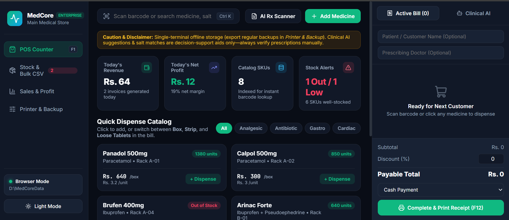
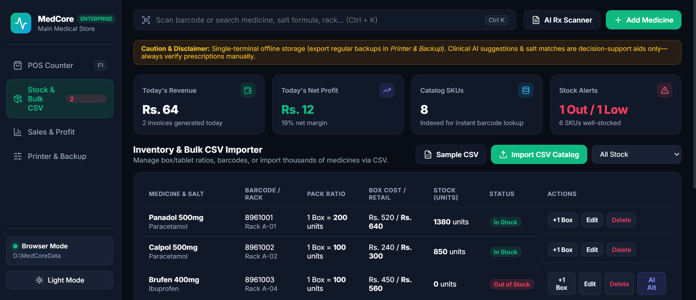
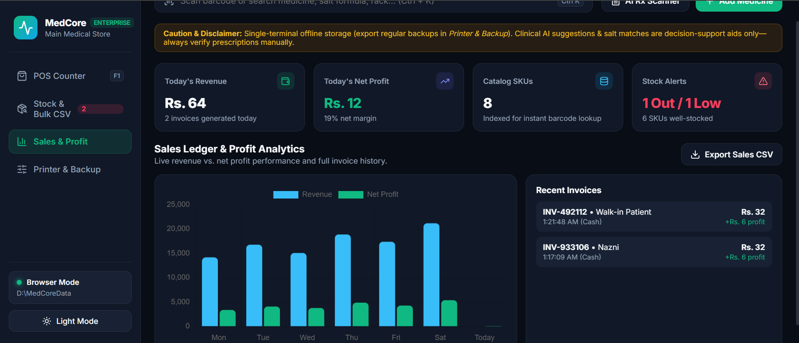

# MedCore AI Pro — Open-Source Pharmacy POS & Inventory System

An offline-first, open-source **Pharmacy Point-of-Sale (POS)**, **Predictive Inventory Manager**, and **Clinical Decision Support Assistant** built with HTML5, CSS3, JavaScript, Chart.js, and Electron. **Zero API keys, backend servers, or recurring subscriptions required.**

---

## Application Previews

### Counter POS & Live Financial KPIs

### Smart Inventory & Bulk CSV Importer

### Revenue, Net Profit/Loss Analytics & Sales Ledger

---
## Key Features

| Module | Capabilities |
| :--- | :--- |
| **Counter POS & Printing** | Fast search by brand, generic salt formula, or rack; optional customer/doctor fields; staff assignment; 1-page **80mm, 58mm, and A4** receipt printing. |
| **Predictive Inventory** | Tracks unit stock counts, purchase vs. retail margins, near-expiry alerts (`<60 days`), and calculates **estimated out-of-stock dates** from daily usage velocity. |
| **Open-Source Clinical AI** | Runs 100% locally with zero API keys—screens carts for duplicate generic salts & drug interactions, recommends in-stock salt substitutes, and auto-fills prescriptions. |
| **Cross-Platform Setup** | Run on the web (Netlify / GitHub Pages), install as a Progressive Web App (PWA), or install natively on Windows 11 via **`MedCore AI Pro Setup.exe`**. |

---

## Quick Start & Installation

### Option 1: Windows Desktop Installer (`.exe`)
1. Download **`MedCore AI Pro Setup 1.0.0.exe`** from the [**Releases**](https://github.com/zahid-ahmedk/medcore-pos/releases) page.
2. Run the installation wizard to add Desktop and Start Menu shortcuts.

### Option 2: Run Locally or Deploy on Web
~~~bash
git clone https://github.com/zahid-ahmedk/medcore-pos.git
cd medcore-pos
# Open index.html in any browser, or run via Electron:
npm install
npm start
~~~

## License
Released under the [MIT License](LICENSE) by **Zahid Ahmed**.